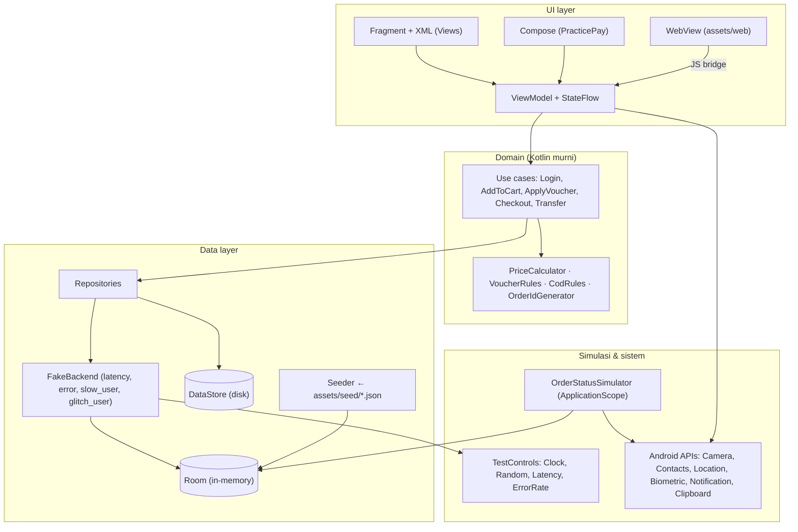
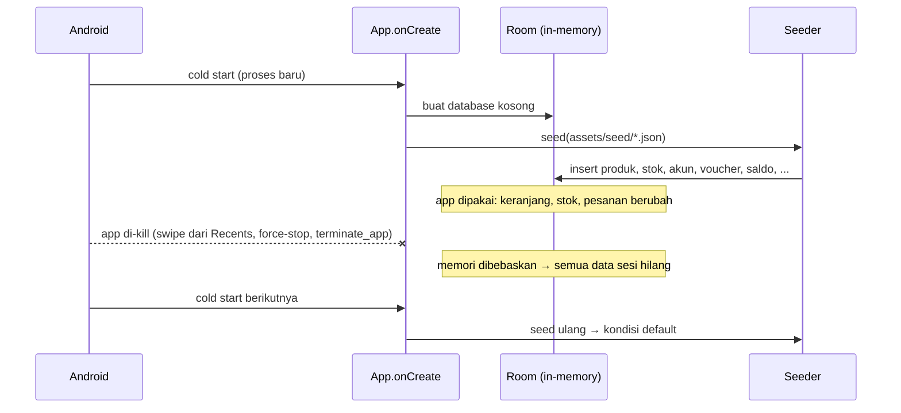

# Architecture — PracticeMart (dengan fitur PracticePay)

| Field | Isi |
|---|---|
| Dokumen | Architecture & Tech Stack |
| Aplikasi | **PracticeMart**, package `com.automation.practice`; PracticePay adalah fitur (tab) di dalamnya |
| Terkait | PRD v0.4 · `design.md` v1.0 |
| Versi | 0.2 (Draft) — nama aplikasi & sinkronisasi dengan `design.md` |
| Tanggal | 12 November 2026 |
| Owner | Dhandy |

---

## 1. Tujuan & prinsip arsitektur
Aplikasi ini adalah **target latihan automation**, bukan aplikasi produksi. Arsitekturnya dioptimalkan untuk lima hal berikut, berurutan menurut prioritas:

1. **Full offline.** Tidak ada backend, tidak ada request jaringan, tidak ada SDK cloud (Firebase, analytics, crash reporting), dan tidak bergantung pada Google Play Services. APK harus jalan di emulator AOSP tanpa Play Store.
2. **Data sesi bersifat sementara.** Keranjang, stok, pesanan, saldo, dan data lain hidup selama proses app hidup. **Saat app di-kill, semua data sesi kembali ke default.** Setiap cold start sama dengan kondisi "baru install", sehingga test isolation terjadi otomatis.
3. **Deterministik & bisa dikontrol.** Waktu, keacakan, delay, dan error disuntikkan lewat satu titik (Developer Options / deep link), bukan tersebar di kode UI.
4. **Testability sebagai kontrak.** resource-id, `testTag`, dan teks assertion diperlakukan sebagai public API (PRD §12).
5. **Sederhana untuk kontributor.** Satu modul Gradle, dependency minimum, tanpa code generation yang berat.

## 2. Ringkasan keputusan
| # | Keputusan | Pilihan | Alasan singkat |
|---|---|---|---|
| D1 | Penyimpanan data sesi | **Room in-memory database** (`Room.inMemoryDatabaseBuilder`) | Bertingkah seperti database sungguhan (query, relasi, transaksi, `Flow`), tetapi otomatis kosong saat proses mati |
| D2 | Penyimpanan pengaturan | **Jetpack DataStore (Preferences)** di disk | Developer Options, bahasa, tema, dan "Ingat saya" sebaiknya tidak hilang setiap kill |
| D3 | Data default | **File JSON di `assets/`** + seeder saat app start | Satu sumber kebenaran yang mudah dibaca, diedit, dan didokumentasikan |
| D4 | "Backend" | **FakeBackend** in-process dengan latency & error injection | API layer terasa nyata (async, bisa lambat/gagal) tanpa jaringan |
| D5 | UI | **Android Views + Material 3**, **Jetpack Compose** khusus PracticePay | Hierarchy UiAutomator paling bersih; Compose dipelajari di konteks nyata |
| D6 | Dependency injection | **Manual DI** (`AppContainer`) | Tanpa Hilt/kapt; lebih mudah dipahami kontributor |
| D7 | QR & kamera | **CameraX + ZXing core** | Decode offline tanpa Play Services (ML Kit unbundled butuh unduhan model) |
| D8 | Lokasi | **`LocationManager` framework** | Bekerja dengan mock location emulator tanpa Fused Location (GMS) |
| D9 | Konten WebView | **`WebViewAssetLoader`** dengan domain lokal palsu | HTML dari `assets/`, URL terlihat realistis (`https://secure.practicebank.test/…`) |
| D10 | Background "server" | **Coroutine di `ApplicationScope`** (bukan WorkManager) | Simulasi status pesanan ikut mati saat app di-kill, konsisten dengan D1 |
| D11 | Mode opsional | Developer Options **"Simpan data setelah app ditutup"** (default OFF) memakai Room file-based | Latihan persistence (PRD EDGE-01) tetap bisa dilakukan |
| D12 | Font & tema | Inter, Space Grotesk, JetBrains Mono **dibundel** di `res/font` (lisensi OFL); token warna/tipografi dari `design.md` → `themes.xml` + Compose `ColorScheme` | Downloadable Fonts butuh Play Services & jaringan; satu sumber token untuk Views dan Compose |

## 3. Tech stack
Versi pasti dikunci di `gradle/libs.versions.toml` saat M1, memakai rilis stabil terbaru pada waktu itu.

| Area | Teknologi | Catatan |
|---|---|---|
| Bahasa | Kotlin 2.x | – |
| Build | Gradle Kotlin DSL, version catalog, Android Gradle Plugin stabil terbaru | `minSdk 24`, `targetSdk`/`compileSdk 35` |
| UI (mayoritas) | Android Views (XML) + ViewBinding, Material Components 3, Navigation Component (Fragment) | resource-id muncul alami di hierarchy |
| UI (PracticePay) | Jetpack Compose + Material 3, di-host dalam Fragment (`ComposeView`) | `testTagsAsResourceId = true` di root (kecuali Riwayat, PRD FR-PAY-11) |
| State | AndroidX ViewModel + Kotlin Coroutines + `StateFlow`; `SavedStateHandle` untuk state form | state bertahan saat rotasi |
| Data sesi | Room (runtime + KTX) dengan **KSP**, mode in-memory | `Flow` dari DAO untuk UI reaktif |
| Pengaturan | DataStore Preferences | disimpan di disk |
| Seed data | kotlinx.serialization (JSON) | parse `assets/seed/*.json` |
| Font | `res/font/` (Inter, Space Grotesk, JetBrains Mono, file TTF/OTF + teks lisensi OFL di `licenses/`) | tanpa Downloadable Fonts |
| Theme | Material 3 `Theme.PracticeMart` (XML) + `PracticeMartTheme` (Compose) yang dibangkitkan dari token `design.md` §2 | satu sumber token |
| Gambar | Coil 3 (**tanpa modul network**) untuk memuat WebP dari `assets/` | placeholder & lazy load; tidak ada OkHttp |
| WebView | AndroidX WebKit (`WebViewAssetLoader`) | 3DS, Pusat Bantuan, S&K |
| Kamera & QR | CameraX (camera2, lifecycle, view) + ZXing core | scan live & decode dari gambar galeri |
| Biometrik | AndroidX Biometric | BiometricPrompt |
| Notifikasi | `NotificationCompat` | notifikasi lokal, bukan push |
| Bahasa per-app | AppCompat `AppCompatDelegate.setApplicationLocales` | ID ↔ EN tanpa restart manual |
| Test (app sendiri) | JUnit4, kotlinx-coroutines-test, Room in-memory test, Espresso (smoke) | logika harga wajib di-unit-test |
| Kualitas | Android Lint, detekt, ktlint, task Gradle `checkLocators` (custom) | lint locator wajib lulus di CI |
| CI | GitHub Actions + `reactivecircus/android-emulator-runner` + Maestro CLI | build APK & e2e smoke |

**Sengaja tidak dipakai**
| Teknologi | Alasan |
|---|---|
| Retrofit / OkHttp / Ktor client | Tidak ada jaringan; FakeBackend cukup |
| Firebase, Crashlytics, analytics | Melanggar prinsip offline & privasi (PRD NFR-10) |
| Google Play Services (Fused Location, ML Kit unbundled, SafetyNet) | Tidak tersedia di emulator AOSP; menambah dependensi online |
| Hilt / Dagger | Code generation & kurva belajar tambahan untuk kontributor |
| WorkManager | Bertahan setelah process death; bertentangan dengan D1 |
| SQLCipher / enkripsi | Tidak ada data sensitif sungguhan |

## 4. Gambaran arsitektur


**Aturan dependensi:** UI → Domain → Data. Domain tidak mengenal Android. Hanya FakeBackend dan Simulator yang membaca `TestControls`, sehingga semua keacakan dan delay terkumpul di satu tempat.

## 5. Struktur project
Satu modul `:app`, package per fitur:
```
app/src/main/
├── java/com/automation/practice/
│   ├── App.kt                    # Application: membuat AppContainer, menjalankan Seeder
│   ├── di/AppContainer.kt        # manual DI
│   ├── core/
│   │   ├── controls/             # TestControls, AppClock, SeededRandom, LatencyPolicy, ErrorPolicy
│   │   ├── session/              # SessionManager (user login, session id)
│   │   ├── deeplink/             # DeepLinkRouter
│   │   ├── locatorhint/          # Locator Hint Overlay
│   │   └── ui/                   # komponen bersama (format Rupiah, snackbar helper), theme/Tokens.kt
│   ├── data/
│   │   ├── db/                   # AppDatabase, entities, DAO
│   │   ├── seed/                 # Seeder, model JSON
│   │   ├── prefs/                # SettingsStore (DataStore)
│   │   ├── backend/              # FakeBackend + "endpoint" per area
│   │   └── repo/                 # CatalogRepo, CartRepo, OrderRepo, WalletRepo, ...
│   ├── domain/                   # PriceCalculator, VoucherRules, use cases
│   ├── feature/
│   │   ├── auth/  shop/  cart/  checkout/  orders/
│   │   ├── wallet/               # Compose
│   │   ├── account/  address/  settings/  help/
│   └── sim/                      # OrderStatusSimulator, VaExpiryWatcher, NotificationPublisher
├── res/                          # layout, values (ID), values-en, drawable, font (Inter, Space Grotesk, JetBrains Mono)
└── assets/
    ├── seed/                     # catalog.json, users.json, vouchers.json, contacts.json,
    │                             # addresses.json, wallet.json, transactions.json
    ├── images/products/          # P001_1.webp …
    └── web/                      # 3ds.html, help.html, terms.html, contact-iframe.html, *.css, *.js
```
Bila nanti build mulai lambat, `domain/` dan `data/` bisa dipecah menjadi modul `:core-domain` dan `:core-data` tanpa mengubah package.

## 6. Data & state
### 6.1 Tiga jenis data
| Jenis | Disimpan di | Umur | Contoh |
|---|---|---|---|
| **Seed (default)** | `assets/seed/*.json` (read-only, ikut APK) | Selamanya | 60 produk + stok awal, 5 akun uji, voucher, kontak, alamat default, saldo awal, 8 transaksi awal |
| **Data sesi** | Room **in-memory** | Selama proses hidup | Keranjang, stok berjalan, wishlist, pesanan & statusnya, alamat yang ditambah, saldo, riwayat transaksi, ulasan, riwayat pencarian, sesi login |
| **Pengaturan** | DataStore (disk) | Sampai "Reset pengaturan" atau *Clear data* | Developer Options, bahasa, tema, notifikasi, onboarding sudah dilihat, username "Ingat saya", mode "Simpan data setelah app ditutup" |

Alasan pengaturan tetap disimpan: CI dan kelas cukup mengatur mode deterministik sekali (atau lewat deep link di setiap test). Data sesi tetap selalu bersih di setiap cold start.

### 6.2 Siklus hidup data sesi


| Peristiwa | Data sesi | Pengaturan |
|---|---|---|
| Rotasi layar, pindah layar, logout–login | tetap | tetap |
| App ke background lalu kembali (proses masih hidup) | tetap | tetap |
| Swipe app dari Recents / force-stop / `adb shell am force-stop` / Appium `terminate_app` / Maestro `stopApp`/`killApp` | **kembali default** | tetap |
| "Reset semua data" / `practiceapp://settings/reset` | kembali default (tanpa kill) | tetap |
| "Reset pengaturan" | tetap | kembali default |
| *Clear data* dari Pengaturan Android / reinstall / Maestro `clearState` | kembali default | kembali default |
| Mode "Simpan data setelah app ditutup" ON | bertahan setelah kill (Room file-based) | tetap |

### 6.3 Process death saat di background
Android bisa mematikan proses app yang sedang di background karena kekurangan memori, lalu memulihkan Activity terakhir saat user kembali. Kalau dibiarkan, layar Checkout bisa muncul dengan keranjang kosong. Penanganannya:
- `SessionManager` membuat `sessionId` baru setiap proses dimulai. `sessionId` ikut disimpan di `savedInstanceState`.
- Base Activity membandingkan keduanya di `onCreate`. Bila berbeda (proses baru, state lama), app **membersihkan back stack dan membuka layar awal** (Onboarding/Login). Hasilnya sama persis dengan kill biasa.
- Perilaku ini didokumentasikan untuk learner sebagai "app selalu mulai dari awal setelah proses mati".

### 6.4 Skema Room (ringkas)
| Entity | Kolom utama | Catatan |
|---|---|---|
| `UserEntity` | username, password, displayName, behavior (`normal/locked/slow/glitch/new`) | dari seed, read-only |
| `ProductEntity` | id (`P001`), name, categorySlug, price, originalPrice, rating, imageCount | read-only |
| `VariantEntity` | productId, color, size, **stock** | stok berubah saat order / batal |
| `CartItemEntity` | username, productId, variantId, qty, selected, savedForLater | gabung bila produk+varian sama |
| `WishlistEntity` | username, productId, position | `position` untuk drag reorder |
| `VoucherEntity` | code, type, value, maxDiscount, minSubtotal, expired | read-only |
| `AddressEntity` | id, username, label, recipient, phone, province, city, street, postalCode, isDefault | – |
| `OrderEntity` | orderId, username, status, method, totals (subtotal, diskon, ongkir, asuransi, layanan, total), createdAt, statusUpdatedAt, vaExpiresAt | totals disalin saat checkout |
| `OrderItemEntity` | orderId, productId, variantId, qty, price | – |
| `WalletEntity` | username, balance, pinAttempts, lockedUntil | – |
| `WalletTxEntity` | id, username, type (`IN/OUT`), title, amount, createdAt | – |
| `ContactEntity` | name, phone, onPracticePay | seed + kontak device (opsional) |
| `ReviewEntity` / `SearchHistoryEntity` | – | – |
| `CounterEntity` | name, value | nomor urut Order ID per tanggal (deterministik) |

Uang selalu disimpan sebagai `Long` dalam Rupiah (tanpa desimal).

### 6.5 Mengganti in-memory ↔ file-based
```kotlin
// AppContainer.kt (ilustrasi)
val persist = settingsStore.persistDataBlocking()   // mode "Simpan data setelah app ditutup"
val db = if (persist) {
    Room.databaseBuilder(app, AppDatabase::class.java, "practice.db").build()
} else {
    Room.inMemoryDatabaseBuilder(app, AppDatabase::class.java).build()
}
if (db.isEmpty()) Seeder(app.assets, db).seed()
```
Mengubah mode ini menampilkan dialog "Perubahan berlaku setelah app dibuka ulang".

## 7. FakeBackend & kontrol test
### 7.1 Kenapa ada "backend"
UI tidak langsung memanggil DAO. UI memanggil repository, lalu repository memanggil FakeBackend yang berperilaku seperti API sungguhan: `suspend`, bisa lambat, bisa gagal. Hasilnya, learner berlatih wait dan retry pada perilaku yang realistis, dan semua perilaku itu bisa dimatikan untuk CI.

```kotlin
// ilustrasi
class FakeBackend(private val controls: TestControls, private val db: AppDatabase) {
    suspend fun <T> call(endpoint: Endpoint, block: suspend () -> T): T {
        delay(controls.latencyFor(endpoint))                 // base × multiplier; slow_user 3–5 dtk
        if (endpoint.flaky && controls.shouldFail(endpoint)) // "Peluang error server"
            throw ServerException("Gagal memuat, coba lagi")
        return block()
    }
}
```

### 7.2 TestControls
| Kontrol | Implementasi | Sumber nilai |
|---|---|---|
| Waktu | `AppClock` (antarmuka); mode deterministik memakai tanggal tetap `2026-01-15` dengan jam berjalan dari 09:41:00 saat start | DataStore / deep link |
| Keacakan | `SeededRandom` (seed tetap bila deterministik, acak bila tidak) | DataStore |
| Latency | `LatencyPolicy`: base per endpoint × multiplier (0×/1×/2×/3×); `slow_user` → 3–5 dtk | DataStore |
| Error server | `ErrorPolicy`: peluang 0/30/50%; deterministik → percobaan ke-1 gagal, ke-2 berhasil | DataStore |
| Animasi | `ValueAnimator.setDurationScale`-like flag + Material motion off; Compose `LocalAnimationsEnabled` | DataStore |
| `glitch_user` | `GlitchRules` dicek di titik tertentu (repo harga, sort, badge) sesuai PRD §8.8 | user aktif |

Deep link `practiceapp://settings?deterministic=true&latency=0&animations=false&flaky=0` hanya menulis DataStore, lalu `TestControls` membaca nilainya lewat `Flow` sehingga langsung berlaku.

## 8. Domain: aturan bisnis
Semua aturan yang menjadi sumber assertion ditulis sebagai fungsi Kotlin murni dan **wajib punya unit test** yang mencakup contoh di PRD §8.7 (total Rp158.000).

| Komponen | Tanggung jawab |
|---|---|
| `PriceCalculator` | Subtotal, diskon voucher, ongkir, potongan ongkir, asuransi, biaya layanan, total |
| `VoucherRules` | Validasi `HEMAT10`, `ONGKIR`, `MIN100K`, `EXPIRED`, kode tidak dikenal (pesan error persis) |
| `ShippingRules` | Ketersediaan Same Day (DKI Jakarta), jam kirim |
| `CodRules` | Limit Rp1.000.000 |
| `CardValidator` | Luhn, kedaluwarsa, kartu uji sukses/ditolak/pending |
| `OrderIdGenerator` | `PM-YYYYMMDD-XXXX` dari `AppClock` + `CounterEntity` |
| `WalletRules` | Minimal transfer, saldo cukup, PIN & penguncian, cashback |
| `RupiahFormatter` | `Rp158.000`; NBSP hanya untuk `glitch_user` |

## 9. Simulasi berjalan di dalam app
| Simulator | Cara kerja | Catatan |
|---|---|---|
| `OrderStatusSimulator` | Coroutine di `ApplicationScope`; setiap interval menaikkan status order aktif dan mengirim notifikasi lokal | ikut berhenti saat proses mati (konsisten dengan D1) |
| Countdown VA, OTP, flash sale, login terkunci | Dihitung dari timestamp (`expiresAt − clock.now()`), bukan timer yang menyimpan sisa detik | tetap benar setelah rotasi |
| `VaExpiryWatcher` | Saat VA lewat batas → order `Dibatalkan`, stok dikembalikan dalam satu transaksi Room | PRD N-09 |
| Banner auto-slide, re-render flash sale | `LaunchedEffect` / `lifecycleScope` dengan interval dari `TestControls` | dimatikan bila Animasi OFF |

## 10. UI layer
- **Navigasi:** `MainActivity` dengan Bottom Navigation + Navigation Component. Activity terpisah (`AuthActivity`, `CheckoutActivity`, `PracticePayActivity`, `SettingsActivity`, `HelpActivity`) semuanya `exported=true` agar bisa dibuka langsung lewat `appActivity` (PRD §15).
- **Pola:** satu ViewModel per layar, `UiState` immutable di `StateFlow`, event satu kali (snackbar, navigasi) lewat `Channel`.
- **Form & rotasi:** nilai form disimpan di `SavedStateHandle` agar checkout utuh setelah rotasi (PRD FR-PAYM-04).
- **Compose islands:** PracticePay di-host di Fragment. Root composable memakai `Modifier.semantics { testTagsAsResourceId = true }`. Riwayat sengaja tanpa `testTag`.
- **Kontrak locator:** id di XML mengikuti PRD §12.1. Task Gradle `checkLocators` mem-parse `res/layout/**` dan konstanta `TestTags.kt`, membandingkannya dengan `docs/locators/*.md`, lalu gagal bila ada id tak terdokumentasi atau duplikat tak disengaja.
- **Locator Hint Overlay:** `ViewTreeObserver` pada root Activity menelusuri View yang punya id dan menggambar label kecil di `ViewOverlay`. Untuk Compose, label digambar oleh modifier debug yang membaca `testTag`. Hanya aktif bila Developer Options menyalakannya.
- **Aksesibilitas:** content-desc hanya untuk label yang bermakna (tombol ikon), touch target ≥ 48dp.
- **Design system:** semua warna, ukuran teks, radius, dan spacing diambil dari token `design.md` §2–§3 lewat `res/values/colors.xml`, `dimens.xml`, `themes.xml`, dan `ui/theme/Tokens.kt` untuk Compose. Tidak ada nilai hex atau dp yang ditulis langsung di layout. Komponen ulang-pakai (tombol utama/sekunder, field, chip, kartu produk, bottom sheet, PIN pad) mengikuti spesifikasi `design.md` §4.

## 11. Deep link & test hooks
- Satu `DeepLinkActivity` (`exported=true`, `launchMode="singleTask"`) menerima skema `practiceapp://`, lalu `DeepLinkRouter` memetakan path ke tujuan navigasi (daftar di PRD §6.2).
- `practiceapp://settings/reset` → `ResetUseCase`: kosongkan Room, jalankan Seeder, hapus sesi login, set "onboarding belum dilihat", lalu buka Onboarding. Proses tidak perlu di-kill.
- `practiceapp://settings?…` → tulis DataStore lalu tutup tanpa UI (cocok untuk setup test).
- Path tidak dikenal → `SYS-01` "Halaman tidak ditemukan".

## 12. WebView
- Semua halaman web disajikan dari `assets/web/` lewat `WebViewAssetLoader` dengan domain lokal palsu, misalnya `https://secure.practicebank.test/3ds.html` dan `https://help.practicemart.test/index.html`. Tidak ada request yang keluar dari device.
- `WebView.setWebContentsDebuggingEnabled(true)` (build debug) agar context `WEBVIEW_com.automation.practice` terlihat di Appium.
- JS bridge: `@JavascriptInterface` pada objek `PracticeBridge` (mis. `PracticeBridge.contactSupport()` → toast native; `PracticeBridge.submit3ds(otp)` → hasil pembayaran).
- `WebChromeClient.onJsConfirm/onJsAlert` memakai dialog bawaan, sehingga `switch_to.alert` bisa dilatih.
- Konten web memakai `id` dan `data-testid` yang stabil (PRD §12.2).

## 13. Integrasi sistem (semuanya offline)
| Kebutuhan | API | Catatan offline / emulator |
|---|---|---|
| Kamera & scan QR | CameraX `ImageAnalysis` + ZXing `MultiFormatReader` | Kamera virtual emulator; alternatif deep link & QR dari galeri |
| QR dari galeri, foto profil, foto ulasan | `ActivityResultContracts.PickVisualMedia` (Photo Picker) | fallback otomatis ke `ACTION_OPEN_DOCUMENT` di Android lama |
| Kontak | `ContactsContract` + kontak seed | bila izin ditolak, hanya kontak seed |
| Lokasi | `LocationManager.getCurrentLocation` / `requestLocationUpdates` (GPS provider) | mock location emulator / Appium `set_location` |
| Biometrik | `BiometricPrompt` | sidik jari emulator (`adb emu finger touch`) |
| Notifikasi | `NotificationCompat` + channel; izin `POST_NOTIFICATIONS` (API 33+) | lokal, tanpa FCM |
| Clipboard | `ClipboardManager` | – |
| Status jaringan | `ConnectivityManager.NetworkCallback` | dipakai hanya untuk menampilkan banner "Tidak ada koneksi" (simulasi), bukan untuk mengirim data |
| Share & dialer | `Intent.ACTION_SEND`, `Intent.ACTION_DIAL` | membuka app lain |
| Bahasa | `AppCompatDelegate.setApplicationLocales` | – |
| Tema | `AppCompatDelegate.setDefaultNightMode` | – |

### 13.1 Permission di manifest
`CAMERA`, `READ_CONTACTS`, `ACCESS_FINE_LOCATION`, `ACCESS_COARSE_LOCATION`, `POST_NOTIFICATIONS`, `USE_BIOMETRIC`, `ACCESS_NETWORK_STATE`.

**Tanpa `INTERNET`.** Ini sekaligus bukti bahwa app benar-benar offline. Perlu diverifikasi di M1 bahwa `WebViewAssetLoader` berjalan normal tanpa permission ini di API 24–35. Bila ternyata dibutuhkan, `INTERNET` ditambahkan dan network security config memblokir semua host selain domain lokal.

## 14. Build, CI & distribusi
| Workflow | Pemicu | Isi |
|---|---|---|
| `build.yml` | push / PR | lint, detekt, ktlint, unit test, `checkLocators`, `assembleDebug`, cek ukuran APK ≤ 25 MB, upload artifact |
| `e2e.yml` | PR ke `main`, nightly | emulator API 33 (x86_64), install APK, set mode deterministik via deep link, jalankan Maestro smoke & E2E-01/02/09 |
| `release.yml` | tag `v*` | build, rename `automation-practice-vX.Y.Z.apk`, buat GitHub Release + CHANGELOG |

- Distribusi memakai build **debug** (debuggable, WebView debugging aktif), ditandatangani dengan keystore debug yang ikut repo agar update APK tidak bentrok signature.
- APK universal tanpa native library selain yang dibawa CameraX (bila ada); target ukuran mengikuti PRD NFR-07.

## 15. Pengujian aplikasi itu sendiri
| Lapisan | Alat | Cakupan minimum |
|---|---|---|
| Domain | JUnit4 | 100% aturan di §8, termasuk contoh Rp158.000 dan semua pesan error voucher |
| Data | Room in-memory + coroutines-test | Seeder menghasilkan data sesuai `docs/test-data.md`; checkout mengurangi stok; batal/VA kedaluwarsa mengembalikan stok |
| Reset | Instrumented test | Reset via deep link dan cold start menghasilkan state identik dengan seed |
| UI | Maestro (di `tests/maestro`) | Smoke per fitur sebagai regression locator |

## 16. Risiko arsitektur
| Risiko | Mitigasi |
|---|---|
| Learner bingung data hilang setelah app ditutup | Dijelaskan di `docs/getting-started.md`; mode "Simpan data setelah app ditutup" untuk latihan persistence |
| Process death di background memunculkan layar dengan data kosong | `sessionId` check (§6.3) |
| Seeder lambat membuat cold start > 2 dtk (PRD NFR-06) | Seed ±60 produk + data kecil; insert dalam satu transaksi; diukur di CI |
| Kamera virtual emulator tidak bisa membaca QR | Deep link simulasi scan + QR dari galeri |
| Perilaku WebView berbeda antar versi Android System WebView | Uji di API 29/33/35; HTML sederhana tanpa API web modern yang rawan |
| Logika test (latency, glitch) bocor ke banyak tempat | Hanya FakeBackend, Simulator, dan `GlitchRules` yang boleh membaca `TestControls` (dicek saat review) |

## 17. Dampak ke PRD (diterapkan di PRD v0.3)
| Bagian PRD | Perubahan |
|---|---|
| §6.3 Prinsip | Tambah prinsip 6: data sesi kembali ke default setiap cold start |
| §7 baris "background / kill / persistence" | Background: state utuh. Kill: kembali default. Persistence: hanya bila mode "Simpan data setelah app ditutup" ON |
| FR-SHOP-17 | Keranjang bertahan selama proses hidup (termasuk logout–login); setelah kill kembali kosong |
| §9 EDGE-01, EDGE-07 | Disesuaikan dengan perilaku kill → default |
| §10 Developer Options | Tambah "Simpan data setelah app ditutup" dan "Reset pengaturan"; jelaskan pengaturan disimpan permanen |
| §13 NFR | NFR-04 tanpa permission `INTERNET`; NFR-14 data sesi kembali default setiap cold start |
| §14 & §15 | `architecture.md` di root repo; baris Persistence menunjuk ke dokumen ini |
| v0.4 | Nama aplikasi PracticeMart (PracticePay sebagai fitur); `design.md` menjadi acuan UI |
