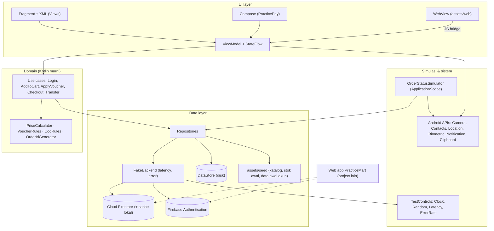
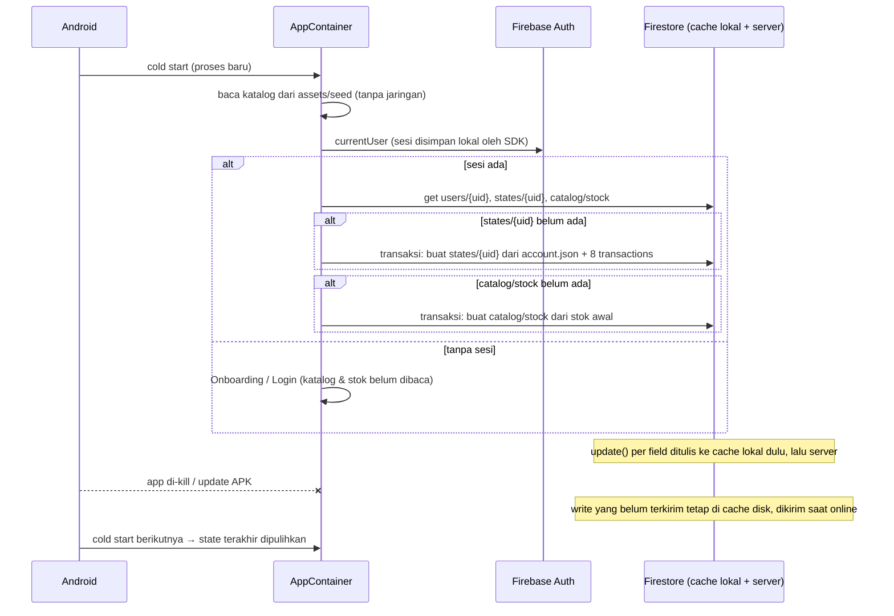

# Architecture — PracticeMart (dengan fitur PracticePay)

| Field | Isi |
|---|---|
| Dokumen | Architecture & Tech Stack |
| Aplikasi | **PracticeMart**, package `com.automation.practice`; PracticePay adalah fitur (tab) di dalamnya |
| Terkait | PRD v0.9 · `docs/contract.md` v1.2 (kontrak bersama dengan web app) · `DESIGN.md` v1.0 |
| Versi | 0.7 (Draft) — Lupa Password di-takeout, Top Up & Kategori dibangun; akun di Firebase Authentication, data di Cloud Firestore; tanpa seeding, tanpa realtime |
| Tanggal | 20 November 2026 |
| Owner | Dhandy |

---

## 1. Tujuan & prinsip arsitektur
Aplikasi ini adalah **target latihan automation**, bukan aplikasi produksi. Arsitekturnya dioptimalkan untuk lima hal berikut, berurutan menurut prioritas:

1. **Cloud tanpa server sendiri.** Backend hanya Firebase Authentication + Cloud Firestore (plan Spark, tanpa Cloud Functions). Tidak ada SDK cloud lain (analytics, crash reporting, FCM, App Check) dan tidak bergantung pada Google Play Services. APK tetap jalan di emulator AOSP tanpa Play Store, tetapi butuh koneksi internet.
2. **Satu sumber data untuk mobile & web.** Akun ada di Firebase Authentication; data per akun dan stok ada di Firestore, sehingga web app PracticeMart (project terpisah) memakai akun & data yang sama. **Data bertahan saat app di-kill, update APK, *Clear data*, dan uninstall.** Tidak ada fitur reset data dan tidak ada seeding dari admin.
3. **Deterministik & bisa dikontrol.** Waktu, keacakan, delay, dan error disuntikkan lewat satu titik (Developer Options / deep link), bukan tersebar di kode UI.
4. **Testability sebagai kontrak.** resource-id, `testTag`, dan teks assertion diperlakukan sebagai public API (PRD §12).
5. **Sederhana untuk kontributor.** Satu modul Gradle, dependency minimum, tanpa code generation yang berat.

## 2. Ringkasan keputusan
| # | Keputusan | Pilihan | Alasan singkat |
|---|---|---|---|
| D1 | Penyimpanan data aplikasi | **Cloud Firestore** (plan Spark) + offline persistence bawaan SDK | Data sama di mobile & web; cache lokal di disk membuat data terbaca saat offline dan write `update()` tidak hilang saat app di-kill |
| D2 | Penyimpanan pengaturan | **Jetpack DataStore (Preferences)** di disk | Developer Options, bahasa, tema, dan "Ingat saya" sebaiknya tidak hilang setiap kill |
| D3 | Data default | **Tanpa seeding.** Katalog, stok awal, dan data awal akun dibundel di APK (`assets/seed/catalog.json`, `assets/seed/account.json`). App menulis data awal akun saat login pertama dan dokumen stok saat pertama dibutuhkan (kontrak §8.3) | Tidak ada script admin, akun uji, atau template di Firestore; katalog tidak memakan kuota read |
| D4 | "Backend" | **FakeBackend** in-process tetap ada, membungkus panggilan Firebase dengan latency & error injection | Perilaku latihan (lambat/gagal) tetap bisa dikontrol, terpisah dari latency jaringan sungguhan |
| D5 | UI | **Android Views + Material 3**, **Jetpack Compose** khusus PracticePay | Hierarchy UiAutomator paling bersih; Compose dipelajari di konteks nyata |
| D6 | Dependency injection | **Manual DI** (`AppContainer`) | Tanpa Hilt/kapt; lebih mudah dipahami kontributor |
| D7 | QR & kamera | **CameraX + ZXing core** | Decode offline tanpa Play Services (ML Kit unbundled butuh unduhan model) |
| D8 | Lokasi | **`LocationManager` framework** | Bekerja dengan mock location emulator tanpa Fused Location (GMS) |
| D9 | Konten WebView | **`WebViewAssetLoader`** dengan domain lokal palsu | HTML dari `assets/`, URL terlihat realistis (`https://secure.practicebank.test/…`) |
| D10 | Background "server" | **Coroutine di `ApplicationScope`** (bukan WorkManager) | Simulasi status pesanan berhenti saat app di-kill. Saat app dibuka lagi, simulator memajukan **satu langkah per tick** untuk pesanan yang `statusAt`-nya sudah lewat interval, dan VA yang lewat `vaDeadline` langsung dibatalkan |
| D11 | Test isolation | Isolasi = **akun baru hasil Register**. `clearState`/`fullReset` hanya menghapus sesi & pengaturan lokal | Data ada di cloud dan dipakai bersama; tidak ada reset dari app dan tidak ada akun uji bersama |
| D12 | Font & tema | Inter, Space Grotesk, JetBrains Mono **dibundel** di `res/font` (lisensi OFL); token warna/tipografi dari `DESIGN.md` → `themes.xml` + Compose `ColorScheme` | Downloadable Fonts butuh Play Services & jaringan; satu sumber token untuk Views dan Compose |
| D13 | Password & PIN | Password dikelola **Firebase Authentication** (app tidak menyimpan password). PIN tetap **hash PBKDF2WithHmacSHA1 + salt** (`javax.crypto`, 10.000 iterasi, salt 16 byte, format `pbkdf2$iterasi$salt$hash`) di Firestore | Firebase menangani hashing password; PIN bukan kredensial Firebase sehingga tetap di-hash oleh app (API 24, tanpa library tambahan). Test vector di kontrak §8.6 |
| D14 | Evolusi skema | Dokumen punya field `schemaVersion`; perubahan hanya aditif (field baru opsional, diberi default saat dibaca); detail `docs/contract.md` §8.5 | Update APK tidak boleh menghapus data user; app versi lama dan web tetap bisa membaca |
| D15 | Akses data | State `StateFlow` di repository = cache di memori. Field per akun (`cart`, `wishlist`, `addresses`, `profile`, PIN, dll.) ditulis dengan `update()` per field; pesanan & transaksi wallet di subkoleksi; `orderSeq`, saldo, stok, dan status pesanan lewat transaksi Firestore (`docs/contract.md` §8.3) | Write biasa diterapkan ke cache disk dulu sehingga aman saat kill; HP & web yang membuka akun yang sama tidak saling menimpa |
| D16 | Autentikasi | **Firebase Authentication email/password**, login selalu dengan email. Register: buat akun → tulis `users/{uid}` → `signOut` → layar Masuk. Tidak ada fitur Lupa Password (di-takeout v0.7) | Tidak butuh Play Services (Firebase Auth ≥ 20.0.0); dipakai juga oleh web. Tanpa lookup username, tanpa perilaku akun khusus |
| D17 | Plan Firebase | **Spark** (gratis): tanpa Cloud Functions & Cloud Storage | Tanpa billing; semua aturan bisnis tetap di client (`domain/`), dijaga Security Rules |
| D18 | Keamanan data | `firebase/firestore.rules` di repo, diuji dengan Firebase Emulator (`docs/contract.md` §8.4) | Config Firebase ikut di APK publik; rules satu-satunya penjaga data |
| D19 | Kontrak lintas platform | Business rules, test data, skema Firestore, Security Rules, aturan tulis, teks bersama, dan format hash PIN ada di **`docs/contract.md`**, disalin identik ke project web | Mobile & web harus menulis data dengan bentuk dan aturan yang sama |
| D20 | Order ID | Nomor urut **per akun** (`orderSeq` di `states/{uid}`), dinaikkan lewat transaksi bersama pembuatan pesanan | Deterministik untuk akun baru; tanpa counter global |
| D21 | Stok | **Global**, satu dokumen `catalog/stock` untuk semua produk, diubah dengan transaksi Firestore. Dibuat client pertama dari stok awal di APK; tidak pernah di-reset otomatis | Stok dipakai bersama semua akun; satu dokumen = 1 read saat cold start (bukan 60) |
| D22 | Sinkron data | **Tanpa realtime.** Hanya `get()` saat layar dibuka atau pull-to-refresh; tidak memakai `addSnapshotListener` / `snapshots()` | Hemat kuota read; perilaku sama dengan web (kontrak §7) |
| D23 | Waktu di cloud | Semua timestamp yang ditulis ke Firestore memakai **jam device asli**, juga saat mode deterministik ON. `AppClock` punya dua fungsi: `realNow()` untuk data cloud, `displayNow()` (tanggal tetap 2026-01-15) untuk tampilan, DatePicker, dan segmen tanggal Order ID | Tanggal palsu di cloud membuat client lain menganggap VA kedaluwarsa dan status melompat (kontrak §5) |

## 3. Tech stack
Versi pasti dikunci di `gradle/libs.versions.toml`, memakai rilis stabil terbaru pada waktu migrasi.

| Area | Teknologi | Catatan |
|---|---|---|
| Bahasa | Kotlin 2.x | – |
| Build | Gradle Kotlin DSL, version catalog, Android Gradle Plugin stabil terbaru, plugin `com.google.gms.google-services` | `minSdk 24`, `targetSdk`/`compileSdk 35`; plugin membaca `app/google-services.json` |
| UI (mayoritas) | Android Views (XML) + ViewBinding, Material Components 3, Navigation Component (Fragment) | resource-id muncul alami di hierarchy |
| UI (PracticePay) | Jetpack Compose + Material 3, di-host dalam Fragment (`ComposeView`) | `testTagsAsResourceId = true` di root (kecuali Riwayat, PRD FR-PAY-11) |
| State | AndroidX ViewModel + Kotlin Coroutines + `StateFlow`; `SavedStateHandle` untuk state form | state bertahan saat rotasi |
| Data aplikasi | Firebase BoM + `firebase-firestore` (offline persistence aktif) | Apache 2.0; artefak utama, **bukan** `-ktx` (sudah dihapus dari BoM); skema di `docs/contract.md` §8.2 |
| Autentikasi | `firebase-auth` (email/password) | tidak butuh Google Play Services sejak 20.0.0 |
| Coroutine Firebase | `kotlinx-coroutines-play-services` | hanya ekstensi `Task.await()` |
| Hash PIN | `javax.crypto.SecretKeyFactory` (`PBKDF2WithHmacSHA1`) + `SecureRandom` | bawaan platform, API 24+ |
| Pengaturan | DataStore Preferences | disimpan di disk (`settings.preferences_pb`) |
| Data bundel | `assets/seed/catalog.json` (katalog + stok awal), `assets/seed/account.json` (data awal akun, kontrak §4.5) | dibaca app; sama isinya dengan bundle web |
| Font | `res/font/` (Inter, Space Grotesk, JetBrains Mono, file TTF/OTF + teks lisensi OFL di `licenses/`) | tanpa Downloadable Fonts |
| Theme | Material 3 `Theme.PracticeMart` (XML) + `PracticeMartTheme` (Compose) yang dibangkitkan dari token `DESIGN.md` §2 | satu sumber token |
| Gambar | Coil 3 (**tanpa modul network**) untuk memuat WebP dari `assets/` | placeholder & lazy load |
| WebView | AndroidX WebKit (`WebViewAssetLoader`) | 3DS, Pusat Bantuan, S&K |
| Kamera & QR | CameraX (camera2, lifecycle, view) + ZXing core | scan live & decode dari gambar galeri |
| Biometrik | AndroidX Biometric | hanya konfirmasi transfer (PRD FR-PAY-08); login sidik jari dihapus |
| Notifikasi | `NotificationCompat` | notifikasi lokal, bukan push |
| Bahasa per-app | AppCompat `AppCompatDelegate.setApplicationLocales` | ID ↔ EN tanpa restart manual |
| Test (app sendiri) | JUnit4 dengan fake `ShopStore` di memori; Espresso (smoke); Firebase Emulator Suite untuk Security Rules & transaksi Firestore | logika harga & hash wajib di-unit-test |
| Kualitas | Android Lint, detekt, ktlint, task Gradle `checkLocators` (custom) | lint locator wajib lulus di CI |
| CI | GitHub Actions + `reactivecircus/android-emulator-runner` + Maestro CLI | build APK & e2e smoke |

**Sengaja tidak dipakai**
| Teknologi | Alasan |
|---|---|
| Retrofit / Ktor client / OkHttp langsung | Tidak ada server sendiri; semua akses data lewat SDK Firebase (Firestore membawa gRPC-OkHttp secara transitif, tidak dipakai langsung) |
| Firebase Analytics, Crashlytics, FCM, Cloud Storage, Cloud Functions, App Check | Di luar kebutuhan; analytics melanggar privasi (PRD NFR-10); Storage & Functions butuh plan Blaze; App Check Play Integrity butuh Play Services |
| Firestore listener (`addSnapshotListener`, `snapshots()`) | Tanpa realtime (D22) |
| Script seed / Admin SDK | Tanpa seeding (D3) |
| Google Play Services (Fused Location, ML Kit unbundled, SafetyNet) | Tidak tersedia di emulator AOSP; tidak dibutuhkan Firebase Auth & Firestore |
| Hilt / Dagger | Code generation & kurva belajar tambahan untuk kontributor |
| WorkManager | Tidak dibutuhkan: simulator jalan saat app terbuka (D10) |
| Room / SQLite lokal | Diganti Firestore + cache offline bawaannya (D1) |

## 4. Gambaran arsitektur


**Aturan dependensi:** UI → Domain → Data. Domain tidak mengenal Android. Hanya FakeBackend dan Simulator yang membaca `TestControls`, sehingga semua keacakan dan delay terkumpul di satu tempat.

## 5. Struktur project
Satu modul `:app`, package per fitur:
```
app/src/main/
├── java/com/automation/practice/
│   ├── App.kt                    # Application: membuat AppContainer
│   ├── di/AppContainer.kt        # manual DI
│   ├── core/
│   │   ├── controls/             # TestControls, AppClock, SeededRandom, LatencyPolicy, ErrorPolicy
│   │   ├── session/              # SessionManager (user login)
│   │   ├── deeplink/             # DeepLinkRouter
│   │   ├── locatorhint/          # Locator Hint Overlay
│   │   └── ui/                   # komponen bersama (format Rupiah, snackbar helper), theme/Tokens.kt
│   ├── data/
│   │   ├── firebase/             # FirestoreShopStore, mapper dokumen ⇄ domain, akses Firebase Auth
│   │   ├── prefs/                # SettingsStore (DataStore)
│   │   ├── backend/              # FakeBackend + "endpoint" per area
│   │   └── repo/                 # CatalogRepo, CartRepo, OrderRepo, WalletRepo, ...
│   ├── domain/                   # PriceCalculator, VoucherRules, use cases
│   ├── feature/
│   │   ├── auth/  shop/  cart/  checkout/  orders/
│   │   ├── wallet/               # Compose
│   │   ├── account/  address/  settings/  help/
│   └── sim/                      # OrderStatusSimulator, VaExpiryWatcher, NotificationPublisher
├── res/                          # layout, values (ID), values-en, drawable, font (Inter, Space Grotesk, JetBrains Mono)
└── assets/
    ├── seed/                     # catalog.json (katalog + stok awal), account.json (data awal akun)
    ├── images/products/          # P001_1.webp …
    └── web/                      # 3ds.html, help.html, terms.html, contact-iframe.html, *.css, *.js

app/google-services.json          # config project Firebase (di-commit, bukan rahasia; D18)
firebase/                         # firebase.json, firestore.rules, test rules & transaksi (root repo)
```
Bila nanti build mulai lambat, `domain/` dan `data/` bisa dipecah menjadi modul `:core-domain` dan `:core-data` tanpa mengubah package.

## 6. Data & state
### 6.1 Tiga jenis data
| Jenis | Disimpan di | Umur | Contoh |
|---|---|---|---|
| **Bundel** | `assets/seed/` + konstanta aturan bisnis di `domain/` | Ikut versi APK | 60 produk, kategori, stok awal, data awal akun (2 alamat, saldo Rp500.000, 8 transaksi, wishlist, riwayat pencarian); voucher, kartu uji, kontak, merchant (konstanta) |
| **Data aplikasi** | Firebase Authentication (akun, password, sesi) + Cloud Firestore (data per akun, stok global) | Permanen di cloud; tidak ada reset dari app | Akun & sesi login, keranjang, voucher aktif, wishlist, riwayat pencarian, pesanan & statusnya, profil, alamat, saldo, PIN (hash) & kunci PIN, riwayat transaksi, nomor urut Order ID; stok berjalan |
| **Pengaturan** | DataStore (disk, per device) | Sampai "Reset pengaturan" / *Clear data* / uninstall | Developer Options, bahasa, tema, notifikasi, onboarding sudah dilihat, email "Ingat saya" |

Data akun ditulis dari `assets/seed/account.json` saat akun pertama kali login (kontrak §8.3). Dokumen `catalog/stock` ditulis dari stok awal `catalog.json` oleh client pertama yang membacanya dan tidak menemukannya.

### 6.2 Siklus hidup data


Gagal membaca `states/{uid}` (tanpa cache & tanpa jaringan) → layar menampilkan `"Gagal memuat, coba lagi"` + tombol `"Coba lagi"` (kontrak §6).

| Peristiwa | Data aplikasi | Sesi login | Pengaturan |
|---|---|---|---|
| Rotasi layar, pindah layar, background | tetap | tetap | tetap |
| Logout–login akun yang sama | tetap (per akun) | – | tetap |
| Swipe dari Recents / force-stop / Appium `terminate_app` / Maestro `stopApp`/`killApp` | **tetap** | **tetap** | tetap |
| Update APK versi Firebase (`adb install -r`, signature sama) | **tetap** | tetap | tetap |
| Login akun yang sama di device lain / web app | **sama** setelah layar dibuka/refresh | per device | per device |
| "Reset pengaturan" | tetap | tetap | kembali default |
| *Clear data* Android / uninstall lalu install / Maestro `clearState` / Appium `fullReset` | **tetap (di cloud)** | keluar | kembali default |

`android:allowBackup="false"`, jadi uninstall tidak memulihkan sesi & pengaturan dari Google Backup.

**Upgrade dari v0.2.x (Room).** Data di `practice.db` (akun lokal, pesanan, saldo) **tidak dimigrasi** ke Firestore. Ini breaking change sekali saja dan dicatat di CHANGELOG; setelah update learner perlu Register.

### 6.3 Process death saat di background
Android bisa mematikan proses app di background lalu memulihkan Activity terakhir. Karena sesi login (Firebase Auth) dan data (cache Firestore) dibaca ulang saat `AppContainer` dibuat, Activity/Fragment yang dipulihkan menemukan data yang sama.

### 6.4 Skema Firestore
Skema lengkap ada di **`docs/contract.md` §8.2**: `users/{uid}`, `states/{uid}` + subkoleksi `orders` & `transactions`, `catalog/stock`. Aturan tulis di §8.3, rules di §8.4.

Pengganti tabel Room: `users` → Firebase Auth + `users/{uid}`; `meta.session_user` → sesi Firebase Auth; `meta.order_seq` → `states/{uid}.orderSeq` (per akun); `accounts`, `cart_items`, `wishlist`, `search_history`, `addresses` → field di `states/{uid}`; `orders` + `order_items` → `states/{uid}/orders/{id}`; `wallet_tx` → `states/{uid}/transactions/{id}`; `stock` → `catalog/stock`.

**Tidak disimpan di Firestore:** katalog (bundel), voucher, kartu uji, kontak, merchant (konstanta di `domain/`, nilainya di kontrak §4), countdown & kunci login 3× gagal (di memori, dihitung dari timestamp), state form checkout (`SavedStateHandle`), akhir flash sale, kontak device (dibaca langsung dari `ContactsContract`). Ulasan (SHOP-07/ORD-04) akan menambah data baru lewat kontrak saat fiturnya dibangun.

**Index:** query yang dipakai hanya `orders` dan `transactions` urut `createdAt`/`at` turun dengan paginasi cursor (20 per halaman); index field tunggal otomatis sudah cukup. Filter Masuk/Keluar & rentang tanggal di Riwayat diterapkan dengan range pada `at` + filter `amount` di client, sehingga tidak butuh index komposit.

### 6.5 Inisialisasi & antarmuka store
```kotlin
// AppContainer.kt (ringkas)
val catalog = CatalogRepository(app.assets)                                // katalog + stok awal dari assets/seed
val auth = AuthRepository(Firebase.auth, Firebase.firestore)                // sesi dari Firebase Auth
val shop = ShopSession(catalog, clock, FirestoreShopStore(Firebase.firestore, app.assets))
```

`ShopStore` yang sekarang (`load`/`save` seluruh `UserState`, sinkron) diganti antarmuka per operasi, semuanya `suspend`:

| Kelompok | Operasi | Cara tulis (kontrak §8.3) |
|---|---|---|
| Baca | `loadState(uid)` (buat dari data awal bila belum ada), `loadStock()` (buat bila belum ada), `orders(uid, page)`, `transactions(uid, page)` | `get()` |
| Field | `setCart`, `setWishlist`, `setHistory`, `setAddresses`, `setProfile`, `setVoucher`, `setPin(hash, failures, lockedUntil)` | `update()` per field |
| Transaksi | `placeOrder(...)`, `advanceStatus(id, expected)`, `cancelOrder(id, reason)`, `transfer(...)`, `payQr(...)` | transaksi Firestore |
| Transaksi | `topUp(amount, title)` | transaksi Firestore (saldo `+n` + dokumen `transactions/`) |

Unit test JVM memakai fake `ShopStore` di memori dengan antarmuka yang sama. Error transaksi dipetakan ke hasil domain (stok kurang, saldo kurang, offline) supaya UI menampilkan teks kontrak §6.

Offline persistence Firestore aktif secara default di Android. Repository menyimpan state di `StateFlow` (cache). `update()` per field tidak menunggu server; SDK menerapkan perubahan ke cache lokal seketika. Transaksi Firestore butuh online, sejalan dengan checkout yang memang butuh koneksi (PRD FR-PAYM-15).

### 6.6 Evolusi skema, Security Rules, kontrak lintas platform
Aturan evolusi skema (`schemaVersion`, perubahan aditif), Security Rules, hash PIN, dan sinkron antar platform ada di **`docs/contract.md` §7–§8**. File rules: `firebase/firestore.rules`, di-deploy dari repo ini. Setiap perubahan skema: ubah kontrak dulu, naikkan versinya, lalu salin ke project web.

## 7. FakeBackend & kontrol test
### 7.1 Kenapa ada "backend"
UI tidak langsung memanggil Firestore. UI memanggil repository, lalu repository memanggil FakeBackend yang berperilaku seperti API sungguhan: `suspend`, bisa lambat, bisa gagal. Hasilnya, learner berlatih wait dan retry pada perilaku yang realistis, dan semua perilaku itu bisa dimatikan untuk CI. Latency jaringan sungguhan ke Firebase terjadi di luar kontrol ini; latency 0× hanya mematikan delay buatan.

```kotlin
// ilustrasi
class FakeBackend(private val controls: TestControls) {
    suspend fun <T> call(endpoint: Endpoint, block: suspend () -> T): T {
        delay(controls.latencyFor(endpoint))                 // base × multiplier
        if (endpoint.flaky && controls.shouldFail(endpoint)) // "Peluang error server"
            throw ServerException("Gagal memuat, coba lagi")
        return block()
    }
}
```

### 7.2 TestControls
| Kontrol | Implementasi | Sumber nilai |
|---|---|---|
| Waktu | `AppClock`: `realNow()` untuk semua data yang ditulis ke Firestore; `displayNow()` memakai tanggal tetap `2026-01-15` dengan jam berjalan sungguhan bila deterministik (D23) | DataStore / deep link |
| Keacakan | `SeededRandom` (seed tetap bila deterministik, acak bila tidak) | DataStore |
| Latency | `LatencyPolicy`: base per endpoint × multiplier (0×/1×/2×/3×) | DataStore |
| Error server | `ErrorPolicy`: peluang 0/30/50%; deterministik → percobaan ke-1 gagal, ke-2 berhasil | DataStore |
| Animasi | `ValueAnimator.setDurationScale`-like flag + Material motion off; Compose `LocalAnimationsEnabled` | DataStore |

Deep link `practiceapp://settings?deterministic=true&latency=0&animations=false&flaky=0` hanya menulis DataStore, lalu `TestControls` membaca nilainya lewat `Flow` sehingga langsung berlaku.

## 8. Domain: aturan bisnis
Semua aturan yang menjadi sumber assertion ditulis sebagai fungsi Kotlin murni dan **wajib punya unit test** yang mencakup contoh di kontrak §2 (total Rp158.000).

| Komponen | Tanggung jawab |
|---|---|
| `PriceCalculator` | Subtotal, diskon voucher, ongkir, potongan ongkir, asuransi, biaya layanan, total |
| `VoucherRules` | Validasi `HEMAT10`, `ONGKIR`, `MIN100K`, `EXPIRED`, kode tidak dikenal (pesan error persis) |
| `ShippingRules` | Ketersediaan Same Day (DKI Jakarta), jam kirim |
| `CodRules` | Limit Rp1.000.000 |
| `CardValidator` | Luhn, kedaluwarsa, kartu uji sukses/ditolak/pending |
| `OrderIdGenerator` | `PM-YYYYMMDD-XXXX` dari `AppClock.displayNow()` + `orderSeq` per akun di `states/{uid}` |
| `WalletRules` | Minimal transfer, saldo cukup, PIN & penguncian, cashback (hanya PracticePay) |
| `RupiahFormatter` | `Rp158.000` |

## 9. Simulasi berjalan di dalam app
| Simulator | Cara kerja | Catatan |
|---|---|---|
| `OrderStatusSimulator` | Coroutine di `ApplicationScope`; tiap tick (1 dtk) memajukan **satu langkah** pesanan aktif yang `realNow() − statusAt ≥ interval`, lewat transaksi kondisional (kontrak §8.3), lalu mengirim notifikasi lokal | Berhenti saat proses mati. Hanya berjalan di client yang sedang terbuka (Android atau web). Pesanan dibaca dari cache `StateFlow`; tidak memakai listener |
| Countdown VA, flash sale, login terkunci | Dihitung dari timestamp (`expiresAt − clock.realNow()`), bukan timer yang menyimpan sisa detik | tetap benar setelah rotasi |
| `VaExpiryWatcher` | Saat VA lewat `vaDeadline` → transaksi batal, stok dikembalikan | PRD N-09; juga dicek saat app dibuka setelah kill |
| Banner auto-slide, re-render flash sale | `LaunchedEffect` / `lifecycleScope` dengan interval dari `TestControls` | dimatikan bila Animasi OFF |

## 10. UI layer
- **Navigasi:** `MainActivity` dengan Bottom Navigation + Navigation Component. Activity terpisah (`AuthActivity`, `CheckoutActivity`, `PracticePayActivity`, `SettingsActivity`, `HelpActivity`) semuanya `exported=true` agar bisa dibuka langsung lewat `appActivity` (PRD §15).
- **Pola:** satu ViewModel per layar, `UiState` immutable di `StateFlow`, event satu kali (snackbar, navigasi) lewat `Channel`.
- **Refresh data:** layar yang menampilkan data cloud memanggil `get()` saat dibuka (`onStart`) dan saat pull-to-refresh; tidak ada listener.
- **Form & rotasi:** nilai form disimpan di `SavedStateHandle` agar checkout utuh setelah rotasi (PRD FR-PAYM-04).
- **Compose islands:** PracticePay di-host di Fragment. Root composable memakai `Modifier.semantics { testTagsAsResourceId = true }`. Riwayat sengaja tanpa `testTag`.
- **Kontrak locator:** id di XML mengikuti PRD §12.1. Task Gradle `checkLocators` mem-parse `res/layout/**` dan konstanta `TestTags.kt`, membandingkannya dengan `docs/locators/*.md`, lalu gagal bila ada id tak terdokumentasi atau duplikat tak disengaja.
- **Locator Hint Overlay:** `ViewTreeObserver` pada root Activity menelusuri View yang punya id dan menggambar label kecil di `ViewOverlay`. Untuk Compose, label digambar oleh modifier debug yang membaca `testTag`. Hanya aktif bila Developer Options menyalakannya.
- **Aksesibilitas:** content-desc hanya untuk label yang bermakna (tombol ikon), touch target ≥ 48dp.
- **Design system:** semua warna, ukuran teks, radius, dan spacing diambil dari token `DESIGN.md` §2–§3 lewat `res/values/colors.xml`, `dimens.xml`, `themes.xml`, dan `ui/theme/Tokens.kt` untuk Compose. Tidak ada nilai hex atau dp yang ditulis langsung di layout. Komponen ulang-pakai (tombol utama/sekunder, field, chip, kartu produk, bottom sheet, PIN pad) mengikuti spesifikasi `DESIGN.md` §4.

## 11. Deep link & test hooks
- Satu `DeepLinkActivity` (`exported=true`, `launchMode="singleTask"`) menerima skema `practiceapp://`, lalu `DeepLinkRouter` memetakan path ke tujuan navigasi (daftar di PRD §6.2).
- Deep link `practiceapp://settings/reset` dihapus (tidak ada reset data).
- `practiceapp://settings?…` → tulis DataStore lalu tutup tanpa UI (cocok untuk setup test).
- Path tidak dikenal → `SYS-01` "Halaman tidak ditemukan".

## 12. WebView
- Semua halaman web disajikan dari `assets/web/` lewat `WebViewAssetLoader` dengan domain lokal palsu, misalnya `https://secure.practicebank.test/3ds.html` dan `https://help.practicemart.test/index.html`. Tidak ada request yang keluar dari device.
- `WebView.setWebContentsDebuggingEnabled(true)` (build debug) agar context `WEBVIEW_com.automation.practice` terlihat di Appium.
- JS bridge: `@JavascriptInterface` pada objek `PracticeBridge` (mis. `PracticeBridge.contactSupport()` → toast native; `PracticeBridge.submit3ds(otp)` → hasil pembayaran).
- `WebChromeClient.onJsConfirm/onJsAlert` memakai dialog bawaan, sehingga `switch_to.alert` bisa dilatih.
- Konten web memakai `id` dan `data-testid` yang stabil (PRD §12.2).

## 13. Integrasi sistem
| Kebutuhan | API | Catatan emulator |
|---|---|---|
| Kamera & scan QR | CameraX `ImageAnalysis` + ZXing `MultiFormatReader` | Kamera virtual emulator; alternatif deep link & QR dari galeri |
| QR dari galeri, foto ulasan | `ActivityResultContracts.PickVisualMedia` (Photo Picker) | fallback otomatis ke `ACTION_OPEN_DOCUMENT` di Android lama |
| Kontak | `ContactsContract` + kontak seed | bila izin ditolak, hanya kontak seed |
| Lokasi | `LocationManager.getCurrentLocation` / `requestLocationUpdates` (GPS provider) | mock location emulator / Appium `set_location` |
| Biometrik | `BiometricPrompt` | konfirmasi transfer; sidik jari emulator (`adb emu finger touch`) |
| Notifikasi | `NotificationCompat` + channel; izin `POST_NOTIFICATIONS` (API 33+) | lokal, tanpa FCM |
| Clipboard | `ClipboardManager` | – |
| Status jaringan | `ConnectivityManager.NetworkCallback` | menampilkan banner "Tidak ada koneksi"; app benar-benar butuh jaringan untuk Firebase |
| Share & dialer | `Intent.ACTION_SEND`, `Intent.ACTION_DIAL` | membuka app lain |
| Bahasa | `AppCompatDelegate.setApplicationLocales` | – |
| Tema | `AppCompatDelegate.setDefaultNightMode` | – |

### 13.1 Permission di manifest
`CAMERA`, `READ_CONTACTS`, `ACCESS_FINE_LOCATION`, `ACCESS_COARSE_LOCATION`, `POST_NOTIFICATIONS`, `USE_BIOMETRIC`, `ACCESS_NETWORK_STATE`, `INTERNET`.

`INTERNET` dibutuhkan Firebase Authentication & Firestore. WebView tetap memuat konten dari `assets/` lewat `WebViewAssetLoader`, tanpa request keluar.

## 14. Build, CI & distribusi
### 14.1 Prasyarat project Firebase (sekali, oleh owner)
| Item | Nilai |
|---|---|
| Project | satu project Firebase untuk Android & web; project ID & owner dicatat di README |
| Plan | Spark |
| Authentication | provider Email/Password aktif; **email enumeration protection aktif** |
| Firestore | database `(default)`, mode Native, rules production. **Region dipilih sekali dan tidak bisa diubah**: `asia-southeast2` (Jakarta) |
| App Android | package `com.automation.practice` terdaftar; `google-services.json` diunduh ke `app/` |
| Rules | `firebase deploy --only firestore:rules` dari folder `firebase/` |

Tidak ada langkah seeding. `catalog/stock` dan data akun dibuat oleh app.

### 14.2 Workflow
| Workflow | Pemicu | Isi |
|---|---|---|
| `build.yml` | push / PR | lint, detekt, ktlint, unit test, `checkLocators`, `assembleDebug`, cek ukuran APK ≤ 25 MB, test Security Rules & transaksi di Firebase Emulator, upload artifact |
| `e2e.yml` | PR ke `main`, nightly | emulator API 33 (x86_64), install APK, set mode deterministik via deep link, jalankan Maestro smoke & E2E-01/02/09 dengan akun CI hasil Register (dibuat sekali, kredensial di GitHub Secrets) |
| `release.yml` | tag `v*` | build, rename `automation-practice-vX.Y.Z.apk`, buat GitHub Release + CHANGELOG |

- `app/google-services.json` di-commit agar CI bisa build; isinya bukan rahasia, keamanan data dijaga Security Rules (D18). Workflow `e2e.yml` butuh internet dan memakai kuota project Firebase.
- Distribusi memakai build **debug** (debuggable, WebView debugging aktif), ditandatangani dengan keystore debug yang ikut repo agar update APK tidak bentrok signature.
- APK debug v0.2.1 = 15,4 MB tanpa Firebase. Build debug tidak di-minify, jadi tambahan Firestore + gRPC + protobuf + Auth **diukur di langkah pertama migrasi** terhadap batas NFR-07 (25 MB). Bila lewat, aktifkan R8 di build debug.
- Versi rilis migrasi: **0.3.0** (pra-1.0, breaking): CHANGELOG mencatat data Room tidak dimigrasi dan "Locator changes" (id OTP, Password Baru, Lupa Password, dan login sidik jari dihapus).

## 15. Pengujian aplikasi itu sendiri
| Lapisan | Alat | Cakupan minimum |
|---|---|---|
| Domain | JUnit4 | 100% aturan di §8, termasuk contoh Rp158.000, semua pesan error voucher, cashback hanya PracticePay |
| Data | JUnit4 + fake `ShopStore` | State tersimpan lalu dipulihkan identik (simulasi kill); per akun terpisah; checkout mengurangi stok; batal/VA kedaluwarsa mengembalikan stok |
| Hash PIN | JUnit4 | test vector kontrak §8.6; hash ≠ plaintext, salt berbeda tiap hash, verify benar/salah |
| Security Rules | Firebase Emulator Suite (`@firebase/rules-unit-testing`) | pemilik bisa baca/tulis datanya; akun lain ditolak; `catalog/stock` hanya create bila belum ada, tanpa key baru, nilai int ≥ 0; path lain ditolak |
| Transaksi Firestore | instrumented test (`androidTest`) terhadap Firestore & Auth Emulator (`useEmulator("10.0.2.2", …)`, atau IP host + `adb reverse` di HP fisik) | `placeOrder` gagal bila stok/saldo kurang; `advanceStatus` dua kali dengan status yang sama hanya maju sekali; cashback DONE sekali; batal dua kali mengembalikan stok sekali; data awal akun dibuat sekali walau dua login bersamaan; timestamp tersimpan = jam asli saat deterministik ON |
| UI | Maestro (di `tests/maestro`) | Smoke per fitur sebagai regression locator |

## 16. Risiko arsitektur
| Risiko | Mitigasi |
|---|---|
| Test saling mengotori state (data cloud dipakai bersama, tanpa reset) | Akun baru hasil Register per test/siswa; dijelaskan di `docs/getting-started.md` |
| Stok global berkurang permanen atau dirusak (siapa pun yang Register bisa menulis `catalog/stock`; config ada di APK publik) | Rules hanya menjaga bentuk (kontrak §8.4). Pemulihan: owner menghapus `catalog/stock` di console, client berikutnya membuatnya ulang. Assertion E2E memakai varian dengan stok besar dan tidak meng-assert angka stok absolut |
| Kuota Spark habis (50.000 read / 20.000 write per hari, Android + web) | Katalog dibundel; stok 1 dokumen; tanpa listener; write hanya saat data berubah. Perkiraan per E2E-01 dengan akun baru: ±15 read, ±35 write (register + data awal 10, keranjang/voucher/wishlist ±10, checkout 1 transaksi, status 4, lainnya) → ±550 run per hari seluruh project. Pantau Usage di Firebase console |
| Limit Register 100 akun/jam per IP | Satu kelas di satu jaringan: siswa Register di awal sesi lalu memakai akunnya terus; suite memakai akun yang sama dan hanya Register saat butuh data bersih |
| Rate limit Firebase Auth (`too-many-requests`) saat suite login berulang atau sengaja salah password | Login sekali per suite lalu pakai sesi; test kredensial salah memakai email yang tidak terdaftar |
| Perubahan skema dokumen merusak data lama atau web app | Aturan `docs/contract.md` §8.5 (aditif, `schemaVersion`); perubahan kontrak di-review di PR dan disalin ke project web |
| Jaringan lambat membuat cold start > 2 dtk (PRD NFR-06) | Katalog dari APK; data akun dari cache Firestore dulu; NFR-06 diukur dengan sesi & cache ada |
| Kamera virtual emulator tidak bisa membaca QR | Deep link simulasi scan + QR dari galeri |
| Perilaku WebView berbeda antar versi Android System WebView | Uji di API 29/33/35; HTML sederhana tanpa API web modern yang rawan |
| Logika test (latency, error) bocor ke banyak tempat | Hanya FakeBackend dan Simulator yang boleh membaca `TestControls` (dicek saat review) |
| Security Rules salah konfigurasi | Rules di repo, test Firebase Emulator di CI, review wajib di PR |
| Firestore di emulator AOSP tanpa Play Services belum diverifikasi di project ini | Dokumentasi Firebase menyatakan Auth & Firestore tidak butuh Play Services; diuji di image AOSP **di langkah pertama migrasi** |

## 17. Dampak ke PRD
| Versi PRD | Perubahan |
|---|---|
| v0.3–v0.5 (historis, sudah tidak berlaku) | Data in-memory lalu Room lokal; tanpa `INTERNET`; reset data |
| v0.6 | Akun & data ke Firebase: §1, §3, §6.3 prinsip 6, FR-AUTH-01/13/14/16/17, FR-SHOP-17, FR-PAY-06, FR-PAYM-13, §8.7, §9 (EDGE-01/07/11), §10 (reset data dihapus), §11, NFR-04/06/10/14/15, §15, §18 |
| v0.7 | Kontrak bersama `docs/contract.md`: §2, §6.3 prinsip 6, FR-SHOP-03, FR-AUTH-13, §8.7, §8.8, §9 (EDGE-11/12), §10, §11 |
| v0.8 | Tanpa seeding & tanpa realtime: akun uji & perilaku khusus dihapus (FR-AUTH-08, FR-AUTH-11, §8.8, N-01, EDGE-05/06), login email (FR-AUTH-03/05/06), Lupa Password netral (FR-AUTH-13), Register → `signOut` (FR-AUTH-12), katalog dibundel (FR-SHOP-03), §6.4, §9, §11, NFR-14, §14, §17, §18 |
| v0.9 | Takeout Lupa Password (AUTH-04, FR-AUTH-13); Top Up disederhanakan (PAY-02, FR-PAY-02); Kategori jadi grid (SHOP-02) |
