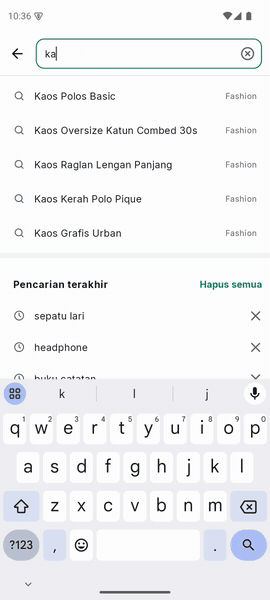
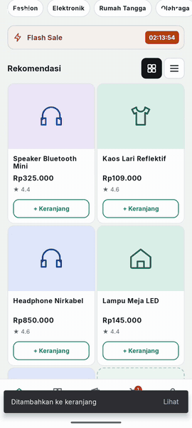
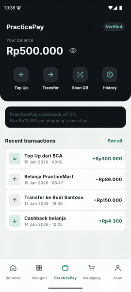

<div align="center">

# PracticeMart

**Aplikasi marketplace Android untuk latihan automation testing mobile.**<br>
Locator stabil, data uji siap pakai, full offline. Cocok untuk Appium dan Maestro.


[**Unduh APK**](https://github.com/dhandyjoe/PracticeMarket.apps/releases/download/v0.1.0/automation-practice-v0.1.0.apk) · [Semua rilis](https://github.com/dhandyjoe/PracticeMarket.apps/releases) · [Dokumentasi](#dokumentasi)

<br>

<table>
  <tr>
    <td align="center"></td>
    <td align="center"></td>
    <td align="center"></td>
  </tr>
  <tr>
    <td align="center"><b>Belanja</b><br><sub>cari, buka produk, tambah ke keranjang</sub></td>
    <td align="center"><b>Checkout</b><br><sub>kartu, 3D Secure, hasil pembayaran</sub></td>
    <td align="center"><b>PracticePay</b><br><sub>transfer dengan PIN</sub></td>
  </tr>
</table>

<sub>Ketiganya dijalankan otomatis oleh [Maestro](https://maestro.mobile.dev). Flow-nya ada di [`docs/media/flows`](docs/media/flows).</sub>

</div>

## Coba sekarang

1. Pasang APK: buka berkas di HP (izinkan sumber tidak dikenal) atau `adb install -r automation-practice-v0.1.0.apk`. Butuh Android 7.0+.
2. Masuk dengan akun uji `standard_user` / `Practice123!`. Kode OTP: `123456`.

## Kenapa PracticeMart

- **Full offline.** Tanpa backend, tanpa permission `INTERNET`. Hasil test tidak bergantung jaringan.
- **Locator adalah public API.** resource-id, `testTag`, dan content-desc terdokumentasi di [`docs/locators`](docs/locators). Id yang berubah dicatat sebagai breaking change.
- **Data permanen, mudah direset.** Akun, keranjang, pesanan, dan saldo tersimpan di database lokal dan bertahan setelah app di-kill atau di-update. Untuk test yang terisolasi: Developer Options › "Reset data setiap app dibuka", `practiceapp://settings/reset`, atau Maestro `clearState`.
- **Skenario nyata.** Login, OTP, pencarian, filter, voucher, kartu dengan 3D Secure, Virtual Account, dan dompet digital PracticePay.

## Dokumentasi

| Dokumen | Isi |
|---|---|
| [PRD.md](PRD.md) | Fitur, skenario E2E, test data, kontrak locator |
| [ARCHITECTURE.md](ARCHITECTURE.md) | Arsitektur, tech stack, skema database |
| [DESIGN.md](DESIGN.md) | Design system dan spesifikasi layar |
| [CLAUDE.md](CLAUDE.md) | Panduan kontributor dan agent |
| Locator | [auth](docs/locators/auth.md) · [shop](docs/locators/shop.md) · [checkout](docs/locators/checkout.md) · [orders](docs/locators/orders.md) · [pay](docs/locators/pay.md) · [account](docs/locators/account.md) |

Bila dokumen berbeda isi, urutan sumber kebenarannya: **PRD → DESIGN → canvas desain**.

## Status

**Sudah ada:** Masuk dan Onboarding, Belanja, Checkout, Pesanan, PracticePay, Akun dan Pengaturan.
**Belum:** Kategori (SHOP-02), Ulasan (SHOP-07, ORD-04), Top Up (PAY-02), halaman tidak ditemukan (SYS-01).

<details>
<summary><b>Deep link dan test hook</b></summary>

<br>

| Deep link | Tujuan |
|---|---|
| `practiceapp://login?username=<x>` | Masuk |
| `practiceapp://register` | Daftar |
| `practiceapp://forgot-password` | Lupa password |
| `practiceapp://shop/orders` | Daftar pesanan |
| `practiceapp://shop/order/{id}` | Detail pesanan |
| `practiceapp://pay` | PracticePay |
| `practiceapp://pay/transfer` · `/history` | Transfer · Riwayat |
| `practiceapp://pay/qr?merchant=KOPIPAGI&amount=28000` | Bayar QR |
| `practiceapp://account` · `/address` | Akun · Alamat |
| `practiceapp://settings` | Pengaturan |
| `practiceapp://help` | Pusat Bantuan |

Test hook tanpa UI:

```
practiceapp://settings/reset
practiceapp://settings?deterministic=true&latency=0&animations=false&flaky=0
```

</details>

<details>
<summary><b>Build dari source</b></summary>

<br>

Prasyarat: JDK 17 dan Android SDK (platform 35, build-tools 35.0.0). Gradle wrapper (8.9) sudah ada di repo.

```
export JAVA_HOME=<path JDK 17>
export ANDROID_HOME=<path Android SDK>
echo "sdk.dir=$ANDROID_HOME" > local.properties
./gradlew :app:testDebugUnitTest      # unit test (domain, hash, persistensi)
./gradlew :app:assembleDebug          # app/build/outputs/apk/debug/app-debug.apk
```

Rekam ulang GIF demo: `docs/media/record-demo.sh` (butuh emulator atau HP tersambung, `maestro`, dan `ffmpeg`).

</details>
